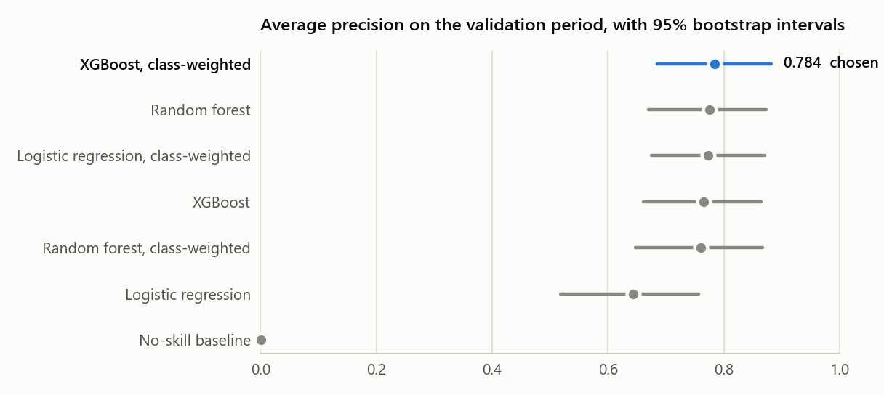
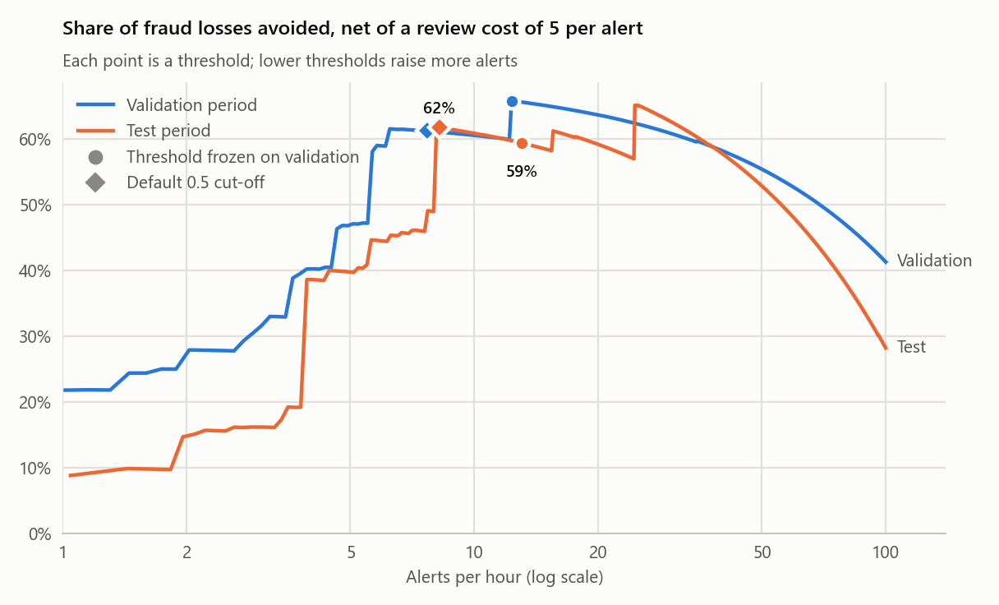

# Credit-Card Fraud Detection on a Chronological Split

[](https://github.com/MarkousOriginal/credit-card-fraud-detection/actions/workflows/tests.yml)

**Author: Markos Pantelis** · [GitHub](https://github.com/MarkousOriginal) · [LinkedIn](https://www.linkedin.com/in/pantelismarkos/)

Fraud detection on 284,807 card transactions made by European cardholders over two days
in September 2013, 0.17% of them fraudulent. Models are trained on the first 33 hours,
compared and tuned on the next 7, and evaluated on the last 8 with the model and
thresholds frozen: the order in which the transactions arrived. The project is packaged as
a tested command-line tool.

## Key results

| Question | Result |
| --- | --- |
| How well does the model rank fraud in a later, unseen period? | Average precision **0.79** (95% CI 0.71–0.87) on the test period, where a no-skill model scores 0.0013 |
| Which model? | Five of six models are within bootstrap noise of each other on validation. Class-weighted XGBoost was chosen because it trains in about 2 seconds, against about a minute for a random forest |
| What would it catch? | At a review cost of 5 per alert: 100 alerts in 7.7 hours (0.18% of transactions), **57 of 74 frauds**, and an estimated **59%** of fraud losses avoided net of review costs |
| Did tuning the threshold pay off? | No. The default 0.5 cut-off avoided 62% on the test period, and any threshold giving 8–25 alerts an hour avoided 57–65% |

## 1. Chronological split

`Time` counts seconds from the first transaction. After 1,081 exact duplicate rows are
removed, the data is sorted by `Time` and cut into three consecutive periods. Cuts fall on
whole seconds, so transactions recorded in the same second stay together.

| Period | Hours | Transactions | Frauds | Fraud rate |
| --- | --- | --- | --- | --- |
| Train | 0.0–33.4 | 170,235 | 342 | 0.20% |
| Validation | 33.4–40.3 | 56,745 | 57 | 0.10% |
| Test | 40.3–48.0 | 56,746 | 74 | 0.13% |

Raw `Time` orders the data but is not a model feature: every validation and test
transaction lies beyond the times seen in training. The features are the 28 anonymised
PCA components `V1`–`V28` and `Amount`.

The fraud rate halves from train to validation. Average precision depends on it (a model
that ranks at random scores the fraud rate), so it is always read next to that rate.

## 2. Model comparison on validation

Every model is trained on the train period and scored on validation. Intervals come from
1,000 bootstrap resamples of the validation transactions.

| Model | Average precision (95% CI) | ROC-AUC |
| --- | --- | --- |
| No-skill baseline (constant score) | 0.001 | 0.500 |
| Logistic regression | 0.643 (0.518–0.757) | 0.969 |
| Logistic regression, class-weighted | 0.773 (0.676–0.871) | 0.971 |
| Random forest | 0.776 (0.670–0.874) | 0.941 |
| Random forest, class-weighted | 0.760 (0.647–0.867) | 0.956 |
| XGBoost | 0.765 (0.661–0.864) | 0.974 |
| **XGBoost, class-weighted** | **0.784 (0.685–0.882)** | **0.974** |



- **Five models are statistically tied.** On paired resamples, only the unweighted logistic
  regression falls reliably below the best model (gap 0.14, 95% CI 0.06–0.23). The other
  four gaps include zero, so class-weighted XGBoost was chosen for its training time, not
  for its accuracy.
- **Class weighting moves the 0.5 cut-off more than the ranking.** At 0.5, the
  class-weighted logistic regression flags 1,993 validation transactions to catch 51 of the
  57 frauds; the unweighted one flags 42.
- **ROC-AUC and average precision disagree.** The random forest has the lowest ROC-AUC of
  the strong models (0.94) but one of the highest average precisions. ROC-AUC is dominated
  by the 56,688 legitimate transactions; average precision by where the 57 frauds rank.

## 3. Cost-based threshold on validation

The cost model rests on three assumptions:

- every alert costs one manual review, whether or not it is a fraud;
- a caught fraud loses nothing, and a missed fraud loses its full `Amount`;
- `Amount` is used as given; the dataset does not state its currency.

For each review cost, the threshold with the lowest total validation cost (reviews plus
missed fraud) is frozen to `policy.json`, with the model in `model.json`. A review cost of 5
was fixed as the headline scenario before the test period was scored.

| Review cost per alert | Threshold | Alerts (per hour) | Frauds caught (of 57) | Fraud losses avoided | Alerts if re-chosen on resamples (95% range) |
| --- | --- | --- | --- | --- | --- |
| 1 | 0.049 | 85 (12.3) | 45 | 69% | 40–1,651 |
| **5** | **0.049** | **85 (12.3)** | **45** | **66%** | **39–85** |
| 10 | 0.049 | 85 (12.3) | 45 | 62% | 39–85 |
| 25 | 0.989 | 43 (6.2) | 41 | 55% | 33–85 |

Between thresholds 0.989 and 0.049 the model raises 42 more alerts and catches 4 more
frauds worth 733 in total, which pays off while a review costs less than about 17. On
resamples of the validation period the cheapest threshold jumps between these regions: the
choice rests on a handful of frauds.

## 4. Final evaluation on test

The test period was scored with the frozen model and thresholds; nothing was changed
afterwards. Average precision is 0.79 (95% CI 0.71–0.87) and ROC-AUC 0.976.

| Policy | Alerts (per hour) | Frauds caught (of 74) | Precision (95% CI) | Recall (95% CI) | Fraud losses avoided (95% CI) |
| --- | --- | --- | --- | --- | --- |
| Review cost 1, threshold 0.049 | 100 (13.1) | 57 | 0.57 (0.48–0.66) | 0.77 (0.68–0.86) | 65% (34–92%) |
| **Review cost 5, threshold 0.049** | **100 (13.1)** | **57** | **0.57 (0.48–0.66)** | **0.77 (0.68–0.86)** | **59% (28–86%)** |
| Review cost 10, threshold 0.049 | 100 (13.1) | 57 | 0.57 (0.48–0.66) | 0.77 (0.68–0.86) | 53% (19–79%) |
| Review cost 25, threshold 0.989 | 57 (7.4) | 52 | 0.91 (0.84–0.98) | 0.70 (0.60–0.80) | 31% (0–62%) |
| Default 0.5 cut-off, review cost 5 | 63 (8.2) | 56 | 0.89 (0.81–0.96) | 0.76 (0.66–0.85) | 62% (31–89%) |



**The threshold chosen on validation did not beat the default cut-off.** The 37 extra
alerts between 0.5 and 0.049 caught one more fraud, worth 2.22; on validation the same band
held two frauds worth 724, which is why it was chosen. Both curves are flat across a wide
band: on test, any threshold giving 8–25 alerts an hour avoids 57–65% of fraud losses. The
gain comes from the model ranking frauds first, not from the exact cut-off.

The intervals on losses avoided are wide because a few large frauds carry much of the
amount: the three largest make up 47% of the test period's fraud losses. Eleven of the 74
test frauds score below 0.001. Lowering the threshold from 0.049 to 0.001 would add 457
alerts and catch 6 more frauds worth 909, a net loss at a review cost of 5, and would still
miss those eleven.

## Methodology

- **Time order is kept.** Train, validation and test are consecutive periods, and raw
  `Time` is not a feature.
- **The test period is held out.** Models are compared and thresholds chosen on validation
  only. The model and thresholds are written to files before the test period is scored, and
  `final` refuses data that splits at different times.
- **Baselines on the same split.** A constant-score model, logistic regression, random
  forest and XGBoost, each with and without class weighting, are scored on the same
  validation transactions.
- **Average precision is defined exactly.** It is scikit-learn's step-wise
  `average_precision_score`, not the trapezoidal area under the precision–recall curve,
  which interpolates and can be optimistic. ROC-AUC is reported alongside.
- **Uncertainty is reported.** Bootstrap 95% intervals (1,000 resamples of each period's
  transactions) for average precision, precision, recall and losses avoided; gaps between
  models use paired resamples.

## Result files

The numbers above are in [`results/`](results/), copied from the runs that produced them:

| Folder | Files |
| --- | --- |
| [`results/evaluate/`](results/evaluate/) | `metrics.csv` (every model, with intervals, gaps to the best model, counts at 0.5 and training time), `splits.csv`, `run.json` |
| [`results/threshold/`](results/threshold/) | `validation_policy.csv`, the frozen `policy.json` and `model.json`, `run.json` (cost assumptions) |
| [`results/final/`](results/final/) | `test_metrics.csv`, `test_policy.csv` (every policy, with intervals), `run.json` |

Rerunning the commands under [Usage](#usage) with the same data and default settings
reproduces these numbers; training times vary by machine.

## Data

[Credit Card Fraud Detection](https://www.kaggle.com/datasets/mlg-ulb/creditcardfraud) on
Kaggle, collected by Worldline and the Machine Learning Group of ULB (Université Libre de
Bruxelles). It is not included in this repository: download `creditcard.csv` into `data/`.
See the dataset page for its license and terms of use.

Dal Pozzolo, A., Caelen, O., Johnson, R. A. and Bontempi, G. Calibrating Probability with
Undersampling for Unbalanced Classification. Symposium on Computational Intelligence and
Data Mining (CIDM), IEEE, 2015.

## Setup

Python 3.12 is tested; 3.10 or later is supported.

```powershell
python -m venv .venv
.venv\Scripts\Activate.ps1          # macOS/Linux: source .venv/bin/activate
python -m pip install -r requirements-tested.txt
python -m pip install -e .
```

## Usage

```bash
# 1. Compare models on the validation period
python -m fraud_ml evaluate --data data/creditcard.csv
# 2. Fit the chosen model and freeze one threshold per review cost, using validation only
python -m fraud_ml threshold --data data/creditcard.csv
# 3. Score the test period with the frozen model and thresholds
python -m fraud_ml final --data data/creditcard.csv
```

Each command writes to `outputs/<command>/`. Run `python -m fraud_ml <command> --help` for
all options, such as `--review-costs`, `--headline-cost` and the split fractions.

## Tests

```bash
python -m unittest discover -s tests -v
```

The tests check duplicate removal, the chronological split (including a burst of
transactions in one second at a cut), that time and label are not features, the cost model
against hand-computed cases, that the frozen threshold is the cheapest on validation, and
that the test run applies the frozen thresholds and rejects data that splits differently.
They run on generated data. GitHub Actions runs them on every push.

## Limitations

- `V1`–`V28` are anonymised PCA components, so features cannot be engineered or explained
  in business terms.
- Two days of data from 2013. Validation and test are single periods of about 7 hours at
  different times of day (the dataset gives no clock time), so results may not hold for
  other periods.
- With 57 validation and 74 test frauds, intervals are wide and the threshold choice rests
  on a few cases.
- The cost model is simple: a fixed review cost, the full loss for a missed fraud and none
  for a caught one, with no customer friction or chargeback costs.
- The model is trained once. In use it would be retrained, and its threshold re-chosen, as
  new labelled transactions arrive.
- Bootstrap intervals treat transactions as independent. Fraud that arrives in bursts would
  make the real uncertainty larger.

## License

[MIT](LICENSE)
